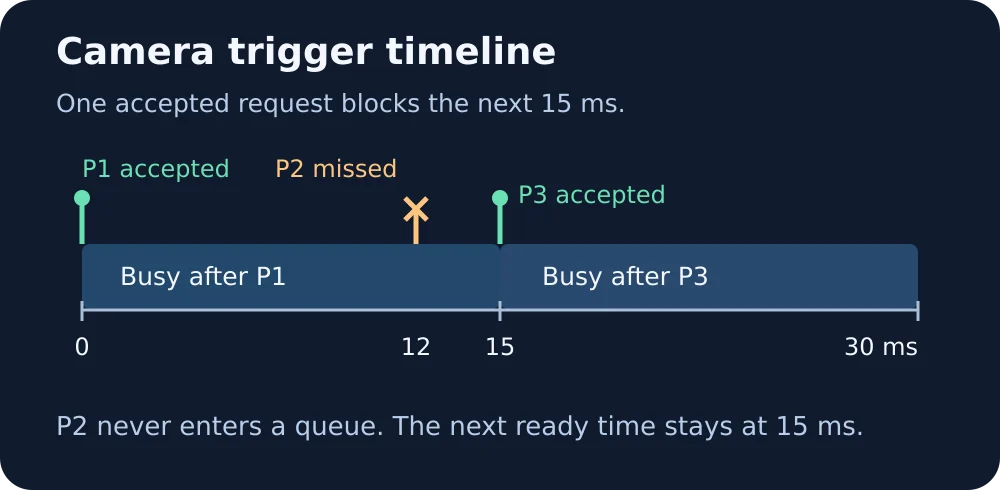

# Machine vision camera trigger replay

[Full WIFA Robotics lesson](https://wifarobotics.com/learn/machine-vision-camera-trigger/)

Use a CSV of one trigger request per part to identify which requests an idealized area scan camera would accept while a fixed busy interval is active. This is an offline model, with no camera SDK, hardware, network connections, or runtime dependencies.

## From zero

1. Install Python 3.12 or later from [python.org](https://www.python.org/downloads/).
2. Download the repository ZIP from **Code → Download ZIP** or use Git. Extract it and open a terminal in the folder that contains `trigger_replay.py`.
3. Check `python3 --version`. On Windows, use `py -3` instead of `python3` in the examples below.

```sh
python3 trigger_replay.py examples/spaced.csv --busy-us 10000
python3 trigger_replay.py examples/busy.csv --busy-us 15000
python3 trigger_replay.py examples/boundary.csv --busy-us 12000
python3 trigger_replay.py examples/out-of-order.csv --busy-us 15000
python3 -m unittest discover -s tests -v
```

The three valid runs report accepted/missed totals of **3/0**, **2/1**, and **2/2**. In the second run P2 is missed at 12,000 µs and P3 is accepted at 15,000 µs. The final example is intentionally invalid and exits with code 2 without emitting a partial report. Decision rows go to stdout and the summary goes to stderr. The CSV must begin with `part,time_us`; each part must be unique. Time starts at zero, must use integer microseconds, and cannot go backwards. Equal timestamps are processed in file order.



For editable image sources, open the SVG files in `diagrams/`. The test suite checks the exact ready boundary, malformed traces, stable ordering of tied timestamps, expected CLI output and 120 independently generated cases against a discrete time oracle. If Python cannot find the files, open the terminal in the extracted project root. If a hand calculation disagrees, confirm milliseconds were converted to microseconds and inspect the ready columns for the preceding accepted request.

The model assumes a camera initially ready, a single fixed busy duration and no trigger queue. It does not model physical signal edges, exposure, image readout, packet loss, clock drift or camera specific buffering. An accepted request in the replay is not proof of an acquired or delivered image. Do not use these numbers as a camera rating or to wire real equipment.
